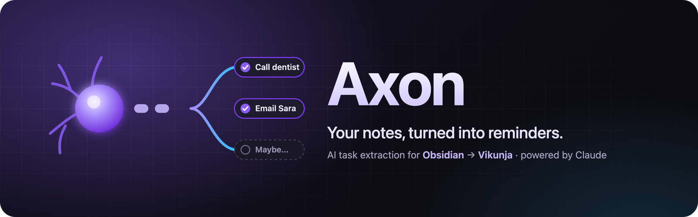
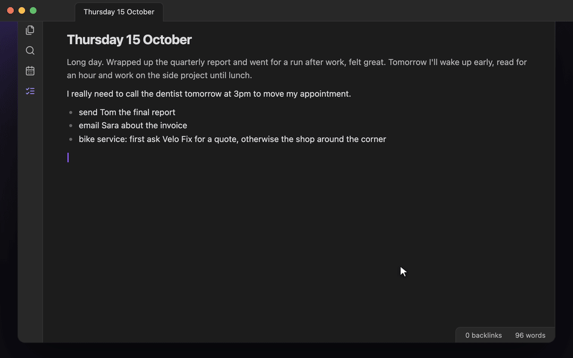
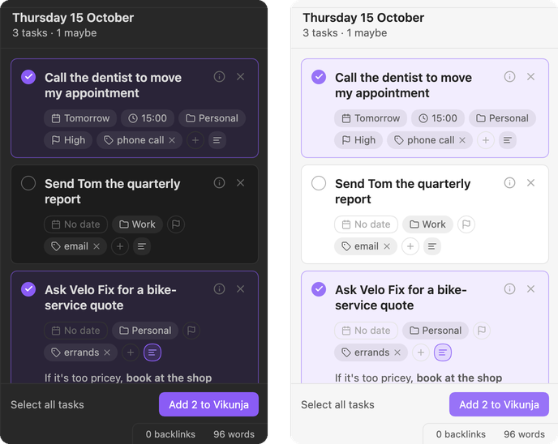

<p align="center">
  
</p>

<p align="center">
  
  
  
  
</p>

<p align="center">
  Write the way you think. <b>Axon</b> reads your note with <b>your own Claude Code</b>, finds what you'd otherwise forget,<br>
  and sends the tasks you pick to <a href="https://vikunja.io">Vikunja</a>, while you keep writing.<br>
  <sub>No API keys: Axon runs on the Claude Code you're already logged into, on your own plan.</sub>
</p>

<p align="center">
  
</p>

## How it works

| | |
|:--|:--|
| **1 · Scan** | Click the ribbon icon or run **Axon: Extract tasks from current note**. A spinner appears in the status bar; keep writing. |
| **2 · Review** | The sidebar opens: sure tasks first, then **Maybe**. Anything already in Vikunja is listed apart, with a link. |
| **3 · Pick** | Click a card to select it. Adjust date, time, project, priority, labels or the Markdown description. |
| **4 · Add** | Press **Add to Vikunja** (<kbd>⌘</kbd>/<kbd>Ctrl</kbd> <kbd>Enter</kbd>). Each task links back to your note. |

## Why it feels different

- **No API keys.** Axon runs your local Claude Code, so it uses your existing login and plan.
- **Reminders, not your agenda.** Habits, routines and time blocks stay out. Only the things you could forget.
- **One goal, one task.** "Ask A for a quote, otherwise B" becomes one task, with the fallback in its description.
- **Nothing leaves without you.** Every draft starts unselected.
- **Knows what's done.** Spots tasks already in Vikunja and remembers what you added or dismissed.
- **Any note.** Journals, meeting notes, brain dumps. "Tomorrow" always means tomorrow.

<p align="center">
  
</p>

## Install

Axon runs on Obsidian desktop (macOS and Linux) and needs:

- [Claude Code](https://claude.com/claude-code), installed and logged in (run `claude` once in a terminal). No API key needed.
- A [Vikunja](https://vikunja.io) API token with **projects** and **labels** (read all), **tasks** (read all, create), **task labels** (bulk) and **task comments** (create).

**BRAT** — install [BRAT](https://github.com/TfTHacker/obsidian42-brat), choose *Add beta plugin* and enter `AbdullahAlhariri/axon`.
**Manual** — copy `main.js`, `manifest.json` and `styles.css` from the [latest release](https://github.com/AbdullahAlhariri/axon/releases/latest) into `<vault>/.obsidian/plugins/axon/`.

Then enable **Axon** under *Settings → Community plugins*, enter your Vikunja URL and token, and press **Test connection**.

<details>
<summary><b>Privacy & disclosures</b></summary>
<br>

- **Network** — to draft tasks, the note's text plus your Vikunja project names, label names and open-task titles are sent to Anthropic through your local Claude Code CLI. Tasks you select are created on *your* Vikunja server.
- **Accounts** — requires a Claude account (via Claude Code) and a Vikunja account.
- **Outside the vault** — Axon runs the `claude` executable installed on your machine.
- **Storage** — settings, including the Vikunja token, live in the plugin's `data.json` inside your vault.
- **No telemetry.**

</details>

<details>
<summary><b>Development</b></summary>
<br>

```bash
npm install
npm test                                   # unit tests
npm run test:claude                        # one real Claude call (~$0.02)
npm run dev                                # rebuild main.js on change
npm run install-plugin -- /path/to/vault   # copy the build into a vault
```

</details>

<p align="center"><sub>MIT © Abdullah Alhariri</sub></p>
